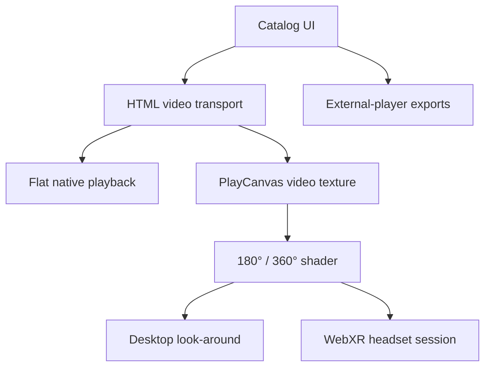

# ProjectAVR

ProjectAVR is a polished, headset-ready video library built with the open-source [PlayCanvas Engine](https://github.com/playcanvas/engine). It presents a streaming-service-style catalog, plays ordinary video efficiently through the browser’s native media element, and maps immersive media onto a PlayCanvas sphere for desktop look-around and WebXR playback.

The app is intentionally static and zero-install at runtime. PlayCanvas `2.21.4`, hls.js `1.7.0`, and dash.js `5.2.0` are loaded from version-pinned jsDelivr URLs. No media is uploaded to ProjectAVR.

## What works

- Flat/regular MP4 and WebM playback
- HLS (`.m3u8`) through native playback or hls.js
- MPEG-DASH (`.mpd`) through dash.js
- 180° and 360° equirectangular video
- Mono, side-by-side, top-bottom, and reversed-eye layouts
- Mouse, touch, wheel, headset pose, and basic XR controller input
- WebXR VR entry on compatible HTTPS headset browsers
- Direct URL, local-file, subtitle URL, and browser-local catalog sources
- Direct URL copying, M3U export, portable metadata export, DeoVR JSON export, and PLAY’A detail export
- Installable PWA metadata, an explicit local-shell cache, and a responsive/accessibility-conscious UI
- Dependency-free Node tests and source validation

## Run locally

Node 20 or newer is the only development prerequisite.

```bash
npm run dev
```

Open `http://localhost:8080`. Browsers treat localhost as a secure context, so it is suitable for local WebXR development on the same machine.

```bash
npm test
npm run validate
npm run check
```

For a physical headset, deploy the static files over HTTPS. A headset connecting to a LAN IP does **not** receive localhost’s secure-context exception.

## Media model

Every source keeps projection and stereo metadata explicit. ProjectAVR never guesses projection from aspect ratio because the same 2:1 frame can represent mono 360° or stereo 180° SBS.

```json
{
  "title": "Example VR180",
  "url": "https://media.example.com/Example_180_LR.mp4",
  "projection": "180",
  "layout": "sbs",
  "streamType": "file",
  "subtitleUrl": "https://media.example.com/Example.en.vtt"
}
```

Projection values are `flat`, `180`, and `360`. Layout values are `mono`, `sbs`, `tb`, `sbs-reverse`, and `tb-reverse`. Stream types are `file`, `hls`, and `dash`.

## External VR players

“Compatible” means ProjectAVR preserves and exports a media source that can be consumed through each player’s documented workflow. A browser cannot universally launch or configure every native VR player. ProjectAVR does not pretend otherwise.

| Player | ProjectAVR handoff | What the player still needs |
|---|---|---|
| PLAY’A | Exported API v2 video-detail payload | A hosted `/api/playa/v2` service with version, config, listing, and detail routes |
| DeoVR | Exported single-video JSON | Host the JSON over HTTPS, then open `deovr://https://…/video.json` |
| SKYBOX VR Player | Filename hint and workflow guidance | Import a local/USB file or use WebDAV, SMB, DLNA, or AirScreen as supported by that player/version; ProjectAVR does not directly launch a URL in SKYBOX |
| Pigasus VR Player | Shared filename hint and original media | Local storage, UPnP/DLNA, or Samba library |
| Whirligig | Original media plus projection/layout guidance | Local file selection or documented PC command-line configuration |

The safest shared fallback is fast-start MP4 with H.264/AVC 8-bit 4:2:0 video and AAC-LC stereo audio. Serve it over HTTPS with byte-range support. See [VR-player compatibility](docs/compatibility.md) and [media-server requirements](docs/media-server.md).

## Architecture



- `src/app.js` owns the catalog, dialogs, player controls, local storage, and exports.
- `src/stream-adapter.js` selects direct, HLS, or DASH playback and cleans up player instances.
- `src/vr-player.js` creates the PlayCanvas app, uploads video frames, projects them, chooses the eye-specific UV region, and starts WebXR.
- `src/media-utils.js` is the normalized model and adapter layer. Its behavior is covered by Node tests.
- `sw.js` caches only an explicit list of local application-shell files. It deliberately bypasses media, Range requests, authenticated requests, and unrelated caches on the same origin.

## Important limits

- Remote immersive video needs correct CORS headers because WebGL must read it as a texture.
- External/native players receive the original URL or file. ProjectAVR does not transcode codecs, add spherical MP4 metadata, remove DRM, or proxy inaccessible origins.
- WebXR availability depends on the browser, headset, secure context, and current session support.
- Stereo sampling uses PlayCanvas’s per-view `view_index`. Test each target headset before production rollout; PlayCanvas does not ship a first-party stereo-video example.
- A static site cannot provide SMB, DLNA, WebDAV, or the dynamic PLAY’A catalog API. Those require a separate server or LAN companion.
- Local-file object URLs exist only for the current page session and cannot be handed to another device.
- The cached local shell and flat-player UI can boot without jsDelivr. First-time immersive playback, HLS fallback, and DASH fallback still need their pinned third-party modules; self-host them if those modes must work deterministically offline.

## Deployment

All production files live at the repository root and use relative URLs, so the project can be hosted from a subpath such as GitHub Pages. Configure the host to serve `index.html`, JavaScript modules, the web manifest, and the service worker over HTTPS.

For production, send security controls as HTTP response headers. The following baseline supports the current pinned jsDelivr modules, arbitrary HTTPS media entered by users, HLS/DASH fetches, blob-backed local files, and the hls.js worker:

```text
Content-Security-Policy: default-src 'self'; script-src 'self' https://cdn.jsdelivr.net; style-src 'self'; img-src 'self' data: blob:; media-src 'self' https: blob:; connect-src 'self' https:; worker-src 'self' blob:; manifest-src 'self'; object-src 'none'; base-uri 'self'; form-action 'self'; frame-ancestors 'none'
Referrer-Policy: no-referrer
X-Content-Type-Options: nosniff
Permissions-Policy: camera=(), microphone=(), geolocation=(), fullscreen=(self), xr-spatial-tracking=(self)
```

If a deployment uses a fixed media catalog, narrow `connect-src` and `media-src` to those CDN origins. Self-hosting the pinned JavaScript modules allows `script-src 'self'` and removes the runtime trust and availability dependency on jsDelivr.

GitHub Pages on GitHub.com does not provide per-repository custom response headers. A CSP `<meta http-equiv>` can enforce many fetch restrictions, but it cannot enforce `frame-ancestors`, and it cannot set the other headers above. Put a configurable CDN/reverse proxy in front of Pages or use a static host that supports response-header configuration when these controls are required. GitHub Enterprise Server administrators can configure Pages response headers at the instance level.

The media origin needs its own CORS, Range, MIME, and authentication configuration; see [media-server requirements](docs/media-server.md).

## Responsible use

Only add media you own or are authorized to stream. ProjectAVR stores ordinary direct-URL metadata in local storage on the current browser; URLs with embedded credentials or common signed-token parameters are session-only. Local media files stay on the device and are not uploaded.

## License

MIT. PlayCanvas is separately distributed under its own MIT license. hls.js is Apache-2.0, and dash.js is BSD-3-Clause.
